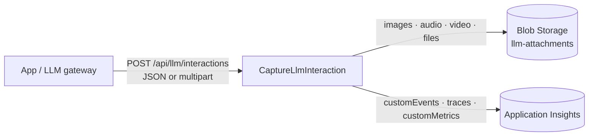

# LLM interaction logger (Azure Functions)

An HTTP-triggered Azure Function (.NET 10, isolated worker) that captures **LLM interactions**: the full
prompt, the full response, token usage and latency, and every attachment sent to or returned by the model
(images, audio, video, PDFs, other files).

- **Binary content** goes to **Azure Blob Storage**.
- **Everything else** (prompt/response text, usage, latency, attachment manifest, metrics) goes to
  **Application Insights** through OpenTelemetry.



## How it works

1. The caller posts one interaction per request, after the LLM call completes.
2. Inline binary content is found anywhere in the JSON (request, response or `attachments`) and
   uploaded to blob storage, then replaced in place with a reference string such as
   `llm-attachment://att-001`. It finds:
   - `data:<mime>;base64,...` URIs, for example OpenAI `image_url.url` and `file.file_data`.
   - Base64 fields such as `data`, `b64_json` and `file_data`, including OpenAI `input_audio`,
     Anthropic `source: {type: base64}`, Gemini `inlineData`, and generated images or audio in responses.
     It uses sibling `mimeType`, `media_type`, `contentType` or `format` hints when present and checks
     magic bytes when they are not.
   - Remote URLs (`https://...`) are **not** fetched; they're logged as-is. This avoids SSRF.
3. Multipart file parts are **streamed** straight to blob storage (never buffered in memory), with
   SHA-256 and a size limit enforced while streaming.
4. The sanitized prompt and response (with binaries replaced by references) are written to
   Application Insights **in full**, split into ordered chunks.
5. If the capture fails, any blobs already written are deleted.

## API

`POST /api/llm/interactions` (function key required: `x-functions-key` header or `?code=`).

### Option A: `application/json`

```jsonc
{
  "interactionId": "optional client id",      // falls back to response.id
  "conversationId": "optional",               // or sessionId / threadId
  "userId": "optional",                       // falls back to request.user
  "application": "optional",
  "provider": "azure-openai",
  "operation": "chat.completions",
  "startedAt": "2026-09-29T10:00:00Z",        // optional
  "completedAt": "2026-09-29T10:00:01.2Z",    // optional; latency is derived if latencyMs is missing
  "latencyMs": 1200,
  "status": "success",                        // defaults to "error" when "error" is present
  "request":  { /* raw provider request, e.g. { model, messages: [...] } */ },
  "response": { /* raw provider response */ },
  "error":    { /* optional */ },
  "usage":    { "inputTokens": 900, "outputTokens": 12 }, // optional; read from response.usage / usageMetadata otherwise
  "attachments": [                            // optional extra files not embedded in request/response
    { "name": "clip.mp4", "contentType": "video/mp4", "data": "<base64>" },
    { "name": "remote.png", "url": "https://example.com/remote.png" }
  ],
  "metadata": { "team": "search" }            // optional; emitted as llm.metadata.* dimensions
}
```

At least one of `request` or `response` is required.

### Option B: `multipart/form-data` (recommended for large video/audio)

- One field named `interaction` holds the JSON envelope above.
- Any number of file parts hold the binaries, streamed to blob storage.

```bash
curl -X POST "$ENDPOINT?code=$KEY" \
  -F 'interaction={"interactionId":"demo-2","request":{"messages":[{"role":"user","content":"Summarize the video"}]},"response":{"output_text":"A cat."}};type=application/json' \
  -F 'files=@clip.mp4;type=video/mp4'
```

### Response: `201 Created`

```json
{
  "captureId": "01a0ee1f0d3875b6927f960f98b1f4c7",
  "interactionId": "demo-1",
  "attachments": [
    {
      "id": "att-001",
      "source": "InlineJson",
      "location": "$.request.messages[0].content[1].image_url.url",
      "contentType": "image/png",
      "sizeBytes": 68,
      "sha256": "63ef31...",
      "container": "llm-attachments",
      "blobName": "2026/09/29/01a0ee1f.../att-001.png",
      "blobUri": "https://<account>.blob.core.windows.net/llm-attachments/2026/09/29/01a0ee1f.../att-001.png",
      "reference": "llm-attachment://att-001"
    }
  ],
  "contentChunks": { "prompt": 1, "response": 1 }
}
```

Errors return `application/problem+json`: `400` (invalid payload), `413` (limit exceeded),
`415` (unsupported content type).

## Where the data goes

| Data | Destination |
| --- | --- |
| Binary attachments | Blob `llm-attachments/{yyyy}/{MM}/{dd}/{captureId}/{attachmentId}[-{fileName}]`. Blob metadata includes `capture_id`, `attachment_id`, `source`, `location` and `sha256`. |
| One summary per interaction | `customEvents` named `LlmInteraction`: model, provider, status, finish reasons, `gen_ai.usage.*` tokens, latency, character and chunk counts, attachment ids and types, `llm.metadata.*` |
| One record per attachment | `customEvents` named `LlmAttachment`: id, reference, location, content type, size, SHA-256, blob URI |
| Full prompt / response / error / attachments JSON | `traces` with `llm.content.kind` = `prompt`, `response`, `error` or `attachments`, chunked with `llm.content.chunk_index` and `llm.content.chunk_count` |
| Metrics | `customMetrics`: `llm.interactions`, `gen_ai.client.token.usage`, `gen_ai.client.operation.duration`, `llm.attachments`, `llm.attachment.bytes` |
| (Optional) sanitized interaction JSON | Blob `llm-interactions/{yyyy}/{MM}/{dd}/{captureId}/interaction.json` when `LlmLogging__ArchiveInteractionJson=true` |

Every record carries `llm.capture_id`, plus `llm.interaction_id` when one is available, so you can join them.

> **Sampling is disabled on purpose.** Azure Monitor OpenTelemetry Exporter 1.6+ rate-limits traces to
> 5/s by default and drops logs tied to unsampled traces. That would silently lose prompts, so
> `Program.cs` sets `SamplingRatio = 1`, `TracesPerSecond = null` and `EnableTraceBasedLogsSampler = false`.
> Plan your Application Insights ingestion budget (daily cap) accordingly.

### KQL: rebuild a full prompt

```kusto
traces
| where customDimensions["llm.capture_id"] == "<captureId>"
| where customDimensions["llm.content.kind"] == "prompt"
| extend idx = toint(customDimensions["llm.content.chunk_index"])
| order by idx asc
| summarize prompt = strcat_array(make_list(tostring(customDimensions["llm.content"])), "")
```

### KQL: token usage and latency by model

```kusto
customEvents
| where name == "LlmInteraction"
| extend model = tostring(customDimensions["gen_ai.request.model"]),
         inTok = tolong(customDimensions["gen_ai.usage.input_tokens"]),
         outTok = tolong(customDimensions["gen_ai.usage.output_tokens"]),
         latency = todouble(customDimensions["llm.latency_ms"])
| summarize calls = count(), inTok = sum(inTok), outTok = sum(outTok), p95LatencyMs = percentile(latency, 95) by model
```

## Configuration

| Setting | Default | Description |
| --- | --- | --- |
| `LlmLogging__BlobServiceUri` | | Blob endpoint for managed identity auth (production). |
| `LlmLogging__BlobConnectionString` | | Connection string (local/Azurite). Takes precedence. |
| `LlmLogging__ManagedIdentityClientId` | | User-assigned identity client ID (blob storage and Application Insights). |
| `LlmLogging__AttachmentsContainer` | `llm-attachments` | Container for binaries. |
| `LlmLogging__InteractionsContainer` | `llm-interactions` | Container for optional JSON archive. |
| `LlmLogging__ArchiveInteractionJson` | `false` | Also archive the sanitized JSON to blob storage. |
| `LlmLogging__MaxJsonBytes` | 100 MB | Max JSON envelope size. |
| `LlmLogging__MaxAttachmentBytes` | 100 MB | Max size per attachment. |
| `LlmLogging__MaxAttachments` | 100 | Max attachments per interaction. |
| `LlmLogging__MinInlineBinaryChars` | 256 | Min length for bare base64 fields without a MIME hint. |
| `LlmLogging__ContentChunkSize` | 8000 | Characters per trace chunk (Application Insights caps property values at 8192). |
| `APPLICATIONINSIGHTS_CONNECTION_STRING` | | Enables the Azure Monitor exporter. |
| `APPLICATIONINSIGHTS_AUTHENTICATION_STRING` | | `ClientId=...;Authorization=AAD` switches the exporter to Entra ID auth. |

The Functions host also limits HTTP request bodies (about 100 MB by default). Use multipart for large media,
and raise the limits only if your plan allows it.

## Run locally

Prerequisites: .NET 10 SDK, Azure Functions Core Tools v4 and Azurite.

```bash
cd functions/llm-interaction-logger
azurite --silent --location /tmp/azurite &          # blob + queue + table emulator
cp src/LlmInteractionLogger/local.settings.sample.json src/LlmInteractionLogger/local.settings.json
cd src/LlmInteractionLogger && func start --port 7203   # or: dotnet run
```

```bash
curl -X POST http://localhost:7203/api/llm/interactions \
  -H 'Content-Type: application/json' \
  -d '{"request":{"model":"gpt-4o","messages":[{"role":"user","content":"hi"}]},"response":{"choices":[{"message":{"content":"hello"}}]}}'
```

To send telemetry to a real Application Insights resource while running locally, set
`APPLICATIONINSIGHTS_CONNECTION_STRING` in `local.settings.json`.

## Test

```bash
cd functions/llm-interaction-logger
dotnet test
```

## Deploy

`infra/main.bicep` provisions these resources:

- A Flex Consumption (FC1) Function App on .NET 10 with a user-assigned managed identity.
- A host storage account and a separate ZRS **data** storage account with the `llm-attachments` and
  `llm-interactions` containers. Both accounts have shared keys disabled and public access off, and the
  data account has lifecycle tiering and deletion rules.
- A Log Analytics workspace and Application Insights with local auth disabled, so ingestion uses Entra ID.
- The role assignments the identity needs: Storage Blob Data Owner (host), Storage Blob Data Contributor
  (data) and Monitoring Metrics Publisher (Application Insights).

```bash
cd functions/llm-interaction-logger
azd up          # or: az deployment group create -g <rg> -f infra/main.bicep -p environmentName=<name>
```

## Security and privacy

Prompts, responses and attachments often contain PII or confidential data.

- Restrict access to the Application Insights resource and the data storage account (RBAC).
- Set retention to match your policy: `logRetentionInDays`, `attachmentsCoolAfterDays` and `attachmentsDeleteAfterDays`.
- Consider adding redaction before calling this function if your compliance rules require it.
- The endpoint uses function-key auth. For production, put it behind API Management or enable
  App Service Authentication (Easy Auth), and consider private endpoints.
