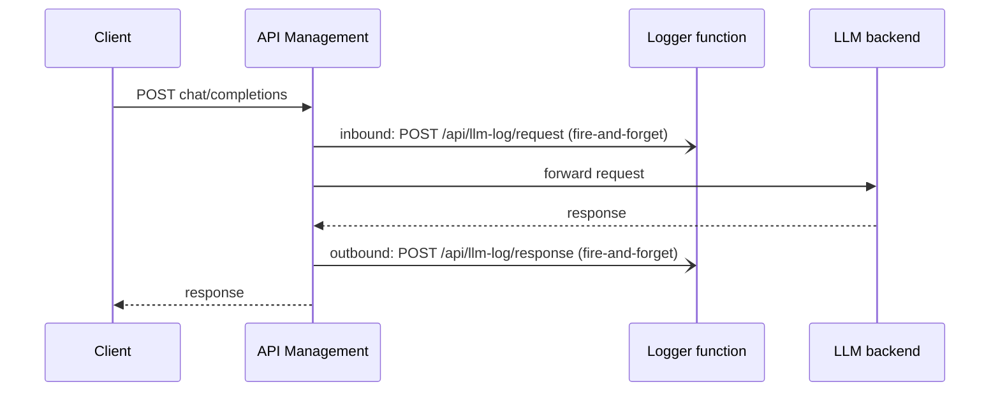

# LLM interaction logger (Azure Functions POC)

A minimal Azure Function (.NET 10, isolated worker) that logs **full LLM prompts and responses** to
**Application Insights**, fed by **Azure API Management** policies:

- **Inbound policy:** sends the prompt to the function, then APIM forwards the request to the LLM unchanged.
- **Outbound policy:** sends the LLM response to the function, then APIM returns it to the client unchanged.

Attachments and media aren't handled separately. The bodies are logged as text, exactly as they pass through APIM.



## Endpoint

`POST /api/llm-log/{request|response}`. A function key is required, in the `x-functions-key` header or the `?code=` query parameter.

- **Body:** the raw prompt or LLM response, logged as-is.
- **Response:** the function returns `200 OK`.

| Header | Purpose |
| --- | --- |
| `x-interaction-id` | Links the request and response. APIM sends `context.RequestId` on both. |
| `x-model` | Model or deployment name. Azure OpenAI puts the deployment in the URL, not the body. |
| `x-status-code` | Backend HTTP status (response only). |
| `x-latency-ms` | Time from APIM receiving the request to the response (response only). |

Each call becomes one or more Application Insights `traces` records. Their `customDimensions` include `Phase`,
`InteractionId`, `Model`, `StatusCode`, `LatencyMs`, `Part`, `Parts` and `Body`. Bodies longer than
8,000 characters are split into ordered parts, because Application Insights truncates property values at 8 KB.

## APIM policy

[`apim/llm-logging-policy.xml`](apim/llm-logging-policy.xml). To use it:

1. Create two named values:
   - `llm-logger-url`: the function app URL, for example `https://func-llmlog-xxxx.azurewebsites.net`.
   - `llm-logger-key`: a function key, marked as **secret**.
2. Apply the policy at API or operation scope on your LLM API.

`send-one-way-request` doesn't wait for the function, so logging adds no latency and can't break the LLM call.
Reading bodies with `preserveContent: true` leaves them intact for the backend and the client.

## Query the logs

Rebuild the prompt and response for one call:

```kusto
traces
| where customDimensions.InteractionId == "<APIM request id>"
| extend phase = tostring(customDimensions.Phase), part = toint(customDimensions.Part)
| order by phase asc, part asc
| summarize body = strcat_array(make_list(tostring(customDimensions.Body)), "") by phase
```

List recent interactions:

```kusto
traces
| where customDimensions.Phase == "response" and toint(customDimensions.Part) == 1
| project timestamp, InteractionId = tostring(customDimensions.InteractionId),
          Model = tostring(customDimensions.Model), StatusCode = tostring(customDimensions.StatusCode),
          LatencyMs = todouble(customDimensions.LatencyMs)
| order by timestamp desc
```

## Run locally

```bash
cd src/LlmInteractionLogger
cp local.settings.sample.json local.settings.json   # set APPLICATIONINSIGHTS_CONNECTION_STRING to send to Azure
azurite --silent &                                  # host storage emulator
func start
```

```bash
curl -X POST http://localhost:7071/api/llm-log/request \
  -H 'x-interaction-id: test-1' -H 'x-model: gpt-4o' \
  -d '{"messages":[{"role":"user","content":"Hello"}]}'

curl -X POST http://localhost:7071/api/llm-log/response \
  -H 'x-interaction-id: test-1' -H 'x-status-code: 200' -H 'x-latency-ms: 420' \
  -d '{"choices":[{"message":{"role":"assistant","content":"Hi!"}}]}'
```

## Deploy

```bash
azd up
```

`infra/main.bicep` creates:

- A Flex Consumption function app with a user-assigned managed identity.
- Host storage with shared keys disabled.
- Log Analytics.
- Application Insights with local auth disabled. The app writes to it with its managed identity.

To get a function key for the APIM named value:

```bash
az functionapp keys list -g <resource-group> -n <function-app> --query functionKeys.default -o tsv
```

## POC limitations

- **Streaming:** reading the response in the outbound policy holds back the whole stream, so the client gets
  all tokens at once when the model finishes.
- **Size:** APIM v2 and Consumption tiers can read at most 2 MiB of a body in a policy.
- **Binary:** bodies are read as text, so binary content (audio, images) isn't preserved.
- **Best-effort delivery:** failed log calls aren't retried.
- **Sensitive data:** prompts and responses are stored in full. Restrict access to Application Insights and
  set an appropriate retention period.
